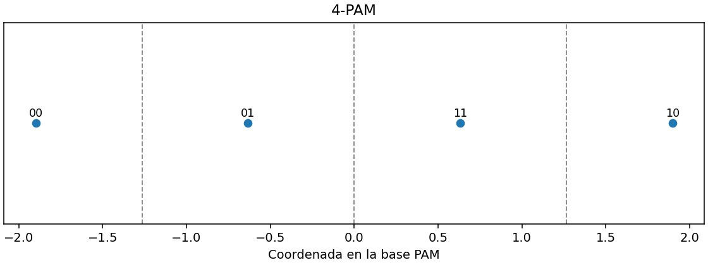
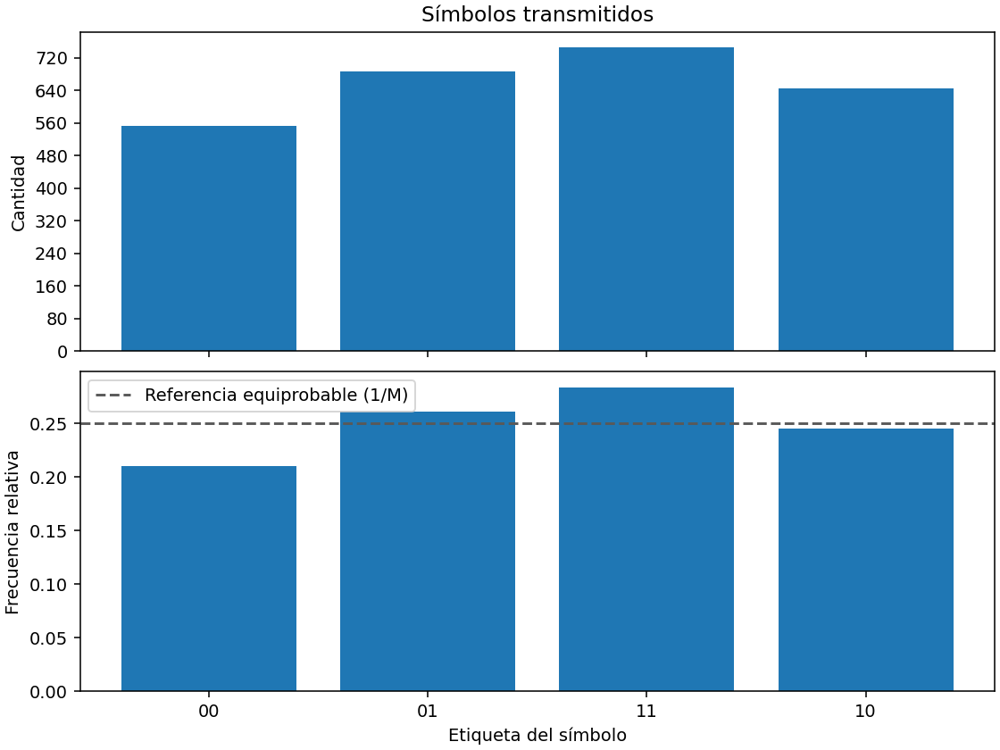
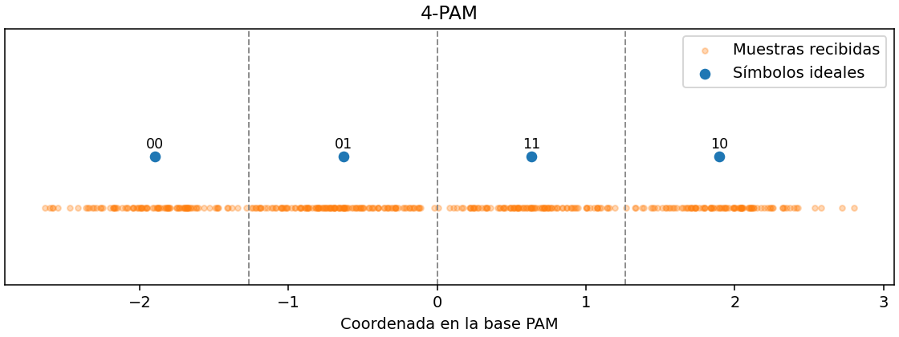

# Datos para el informe de modulación y canal

- Entrada: `res/textito.txt` (1171 caracteres).
- Bits codificados con Huffman: 5264.
- Configuración de los gráficos y la corrida con ruido: 4-PAM Gray.
- Energía nominal de bit Eb = 1 en unidades normalizadas y tasa de código = 1.

## D. Energías y probabilidades por esquema y orden

Las energías estimadas se calcularon sobre los símbolos transmitidos del texto indicado.
Las probabilidades teóricas corresponden a AWGN a 6 dB, con símbolos equiprobables.

| Esquema | M | Es teórica | Eb teórica | Es estimada | Eb estimada | SER teórica | BER Gray | BER binaria |
| --- | ---: | ---: | ---: | ---: | ---: | ---: | ---: | ---: |
| PAM | 2 | 1 | 1 | 1 | 1 | 0.00238829078 | 0.00238829078 | 0.00238829078 |
| PAM | 4 | 2 | 1 | 1.85775076 | 0.92887538 | 0.0557426126 | 0.0278713278 | 0.037161731 |
| PAM | 8 | 3 | 1 | 2.7563121 | 0.918770701 | 0.250418 | 0.0838167831 | 0.131056643 |
| PAM | 16 | 4 | 1 | 3.65728589 | 0.914321473 | 0.506680626 | 0.14113988 | 0.216829233 |
| FSK | 2 | 1 | 1 | 1 | 1 | 0.0230071389 | 0.0230071389 | 0.0230071389 |
| FSK | 4 | 2 | 1 | 2 | 1 | 0.00666417174 | 0.00444278116 | 0.00444278116 |
| FSK | 8 | 3 | 1 | 3 | 1 | 0.00176008949 | 0.00100576542 | 0.00100576542 |
| FSK | 16 | 4 | 1 | 4 | 1 | 0.000453851816 | 0.000242054302 | 0.000242054302 |

## D. Constelación e histograma del transmisor

Los conteos de la tabla siguiente usan todos los símbolos transmitidos.
La frecuencia de referencia equiprobable es 1/M = 0.25.
La tabla de errores para esta configuración usa la corrida con AWGN descrita en E.

## DATOS DE MODULACIÓN Y DEMODULACIÓN

- Esquema: PAM
- Orden M: 4
- Etiquetamiento: gray
- Energía nominal Eb de información: 1
- Tasa de código k/n: 1

### 1. ENERGÍAS MEDIAS

| Magnitud | Teórica | Estimada |
| --- | ---: | ---: |
| Es (símbolo de modulación) | 2 | 1.85775075988 |
| Ec (bit de canal) | 1 | 0.928875379939 |
| Eb (bit de información) | 1 | 0.928875379939 |

Energías expresadas en unidades normalizadas.

### 2. PROBABILIDADES DE ERROR

| Magnitud | Referencia teórica (AWGN) | Estimada (simulación) |
| --- | ---: | ---: |
| SER | 0.0557426126393 | 0.0623100303951 |
| BER | 0.0278713278452 | 0.0311550151976 |

Las probabilidades son adimensionales. La referencia teórica supone
símbolos equiprobables y recepción coherente, antes de decodificar el canal.

### 3. OCURRENCIA DE SÍMBOLOS MODULADOS

| Etiqueta | Cantidad | Probabilidad observada |
| --- | ---: | ---: |
| 00 | 553 | 0.210106382979 |
| 01 | 686 | 0.260638297872 |
| 11 | 747 | 0.283814589666 |
| 10 | 646 | 0.245440729483 |

## E. Muestras a la entrada del receptor

- Canal AWGN a 6 dB. Semilla del generador: 42.
- N0 = 0.251188643. Varianza del ruido por coordenada: 0.125594322.
- Símbolos transmitidos y evaluados para la SER: 2632.
- Bits recuperados tras demodular: 5264.
- Bits descartados al modular: 0.
- Bits errados para la BER: 164 de 5264.
- La figura muestra 400 muestras recibidas, seleccionadas de la corrida completa.

